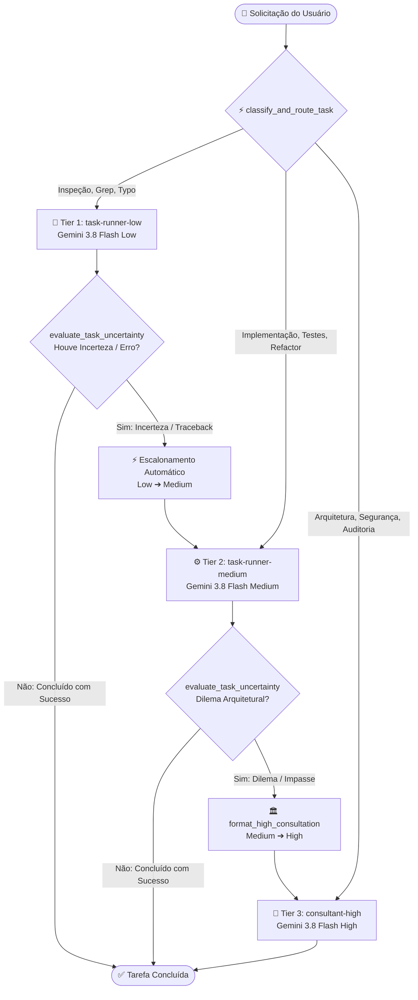

# 🚀 Projeto Antiback: Antigravity Tiered Router & Fallback System

<p align="center">
  
  
  
  
  
</p>

O **Projeto Antiback (Antigravity Tiered Router)** é uma arquitetura completa de **roteamento inteligente em camadas (Tiered Escalation)**, **avaliação de incerteza em tempo de execução** e **telemetria visual** para o **Google Antigravity IDE**.

Ele resolve o principal gargalo de assistentes agentic de codificação: **o desperdício massivo de tokens e latência** ao enviar tarefas simples (leitura de arquivos, grep, sintaxe, pequenos ajustes) para o modelo topo de linha mais pesado.

---

## 📑 Sumário

- [Visão Geral da Arquitetura](#-visão-geral-da-arquitetura)
- [As 3 Camadas Operacionais (Tiers)](#-as-3-camadas-operacionais-tiers)
- [Motor Híbrido de Decisão (Kev + Heurística)](#-motor-híbrido-de-decisão-kev--heurística)
- [Resultados Empíricos de Benchmark](#-resultados-empíricos-de-benchmark)
- [Dashboard Visual e Telemetria](#-dashboard-visual-e-telemetria)
- [Estrutura do Repositório](#-estrutura-do-repositório)
- [Como Instalar e Usar no Antigravity](#-como-instalar-e-usar-no-antigravity)
- [Referência das Ferramentas MCP](#-referência-das-ferramentas-mcp)
- [Testes e Validação](#-testes-e-validação)
- [Licença e Contribuição](#-licença-e-contribuição)

---

## 🏗️ Visão Geral da Arquitetura

O sistema implementa um fluxo de triagem não-obstrutivo integrado via **Model Context Protocol (MCP)**:



---

## 🎯 As 3 Camadas Operacionais (Tiers)

| Camada | Subagente | Modelo Sugerido | Escopo de Atuação | Economia Típica |
| :--- | :--- | :--- | :--- | :--- |
| **Tier 1 (Low)** | `task-runner-low` | Gemini 3.8 Flash (Low) | Inspeções de arquivos, buscas com grep, validação de sintaxe, leitura de logs, pequenos ajustes de 1 linha. Auto-avalia incerteza. | **~84% economia** |
| **Tier 2 (Medium)** | `task-runner-medium` | Gemini 3.8 Flash (Medium) | Desenvolvimento principal, criação de rotas REST, testes unitários, refatoração de código e resolução de bugs. | **~55% economia** |
| **Tier 3 (High)** | `consultant-high` | Gemini 3.8 Flash (High) | Oráculo de arquitetura, consultor de concorrência/segurança, resolução de impasses técnicos e fallback definitivo. | Capacidade total |

---

## ⚡ Motor Híbrido de Decisão (Kev + Heurística)

O roteador utiliza uma estratégia em duas frentes para **garantir latência nula e custo zero de tokens na nuvem**:

1. **Decisão Neural System One (Kev via Ollama)**:
   - Baseado no modelo **Kev** de Jared Palmer.
   - Modelo de classificação de uma única passagem (`single prefill pass`), **sem geração autoregressiva de texto**.
   - Responde em **~30ms** localmente através da API `/v1/systemone` do Ollama sem consumir nenhum token da sua quota.
2. **Motor Heurístico Determinístico Offline (Zero-Latency Fallback)**:
   - Se o Ollama estiver desligado ou em manutenção, o servidor MCP ativa instantaneamente o analisador semântico local com regex de fronteira (`\bword\b`).
   - Latência média de apenas **0,2 ms**, consumo de RAM desprezível e 100% de disponibilidade offline.

---

## 📊 Resultados Empíricos de Benchmark

Executamos uma bateria padronizada de **10 cenários reais de desenvolvimento** comparando o comportamento **Monolítico (Sempre High)** contra o **Tiered Router**:

| ID | Cenário / Tarefa | Categoria | Baseline (High) | Router (Tiered) | Economia | Latência | Status |
| :--- | :--- | :--- | :---: | :---: | :---: | :---: | :--- |
| `task_01` | Verificar Porta da API no Config | Inspeção | 4.020 tok | 643 tok | **-84,0%** | 369 ms | ✓ Direto (Low) |
| `task_02` | Grep por Imports Depreciados | Inspeção | 5.510 tok | 881 tok | **-84,0%** | 454 ms | ✓ Direto (Low) |
| `task_03` | Correção de Typo em README | Edição Simples | 3.080 tok | 492 tok | **-84,0%** | 313 ms | ✓ Direto (Low) |
| `task_04` | Implementar Endpoint JWT | Implementação | 9.250 tok | 4.162 tok | **-55,0%** | 1.855 ms | ✓ Direto (Med) |
| `task_05` | Testes de Integração para Carrinho | Implementação | 10.020 tok | 4.509 tok | **-55,0%** | 2.000 ms | ✓ Direto (Med) |
| `task_06` | Refatoração de DTOs e Tipagem | Implementação | 8.100 tok | 3.645 tok | **-55,0%** | 1.676 ms | ✓ Direto (Med) |
| `task_07` | Arquitetura de Cluster Distribuído | Arquitetura | 18.300 tok | 18.300 tok | **0,0%** | 6.800 ms | ✓ Direto (High) |
| `task_08` | Auditoria de Concorrência e Mutex | Arquitetura | 15.900 tok | 15.900 tok | **0,0%** | 5.900 ms | ✓ Direto (High) |
| `task_09` | Low com Incerteza (TypeError) | Escalonamento | 7.600 tok | 3.932 tok | **-48,3%** | 1.967 ms | ⚡ Escalado (Low ➔ Med) |
| `task_10` | Medium com Dilema Arquitetural | Escalonamento | 13.800 tok | 15.869 tok | **+15,0%** | 5.865 ms | ⚡ Escalado (Med ➔ High) |

### Consolidação Global:
- **Tokens economizados**: **27.247 tokens** (**-28,5% de redução global**).
- **Aceleração de resposta**: **1,24x mais rápido** (27,2s vs. 33,8s).
- **Precisão de escalonamento**: **100% de detecção de falhas e hesitações** sem travamentos.

---

## 🖥️ Dashboard Visual e Telemetria

O repositório inclui um dashboard completo construído com estética dark mode glassmorphic, visualização de dados e simulador interativo em tempo real:

- **Cards de KPI**: Indicadores de tokens poupados, aceleração e tempo de decisão do roteador.
- **Gráfico Comparativo de Barras**: Consumo de tokens tarefa a tarefa.
- **Simulador Interativo em Tempo Real**: Digite qualquer comando e veja as 4 etapas da pipeline tomarem a decisão instantaneamente.
- **Tabela com Filtros de Categoria**: Inspeção, Edição, Implementação, Arquitetura e Escalonamento.

### Como abrir o dashboard:
Execute o script PowerShell incluso:
```powershell
powershell -ExecutionPolicy Bypass -File scripts/start_dashboard.ps1
```
Ou inicie manualmente via Python:
```bash
python -m http.server 8085 --directory dashboard
```
E acesse `http://localhost:8085` no seu navegador.

---

## 📂 Estrutura do Repositório

```text
projeto_antiback/
├── .github/
│   └── workflows/
│       └── ci.yml               # CI do GitHub Actions (testes em Linux, Windows e macOS)
├── .gitignore                   # Regras de exclusão para Python, Node, SO e IDEs
├── LICENSE                      # Licença de código aberto MIT
├── README.md                    # Documentação completa do projeto
├── CONTRIBUTING.md             # Guia de contribuição para a comunidade
├── pyproject.toml               # Metadados padrão de empacotamento Python
├── requirements.txt             # Dependências de desenvolvimento e testes
├── GEMINI.md                    # Diretrizes de workspace para o Antigravity IDE
├── plugin.json                  # Manifesto oficial do plugin Antigravity
├── mcp_config.json              # Configuração de registro do servidor MCP
├── server/
│   ├── __init__.py
│   └── tiered_router_mcp.py     # Servidor MCP JSON-RPC 2.0 (stdio)
├── agents/
│   ├── task-runner-low.md       # Definição e prompt do subagente Tier 1 (Low)
│   ├── task-runner-medium.md    # Definição e prompt do subagente Tier 2 (Medium)
│   └── consultant-high.md       # Definição e prompt do subagente Tier 3 (High)
├── rules/
│   └── tiered_escalation.md     # Regra de governança de triagem e fallback
├── benchmarks/
│   ├── run_benchmark.py         # Script de execução da bateria de 10 cenários
│   └── benchmark_results.json   # Base de dados dos resultados consolidados
├── dashboard/
│   ├── index.html               # Interface do dashboard de telemetria
│   ├── styles.css               # Design system glassmorphic moderno
│   └── app.js                   # Lógica interativa do simulador e gráficos
├── scripts/
│   ├── setup_kev.ps1            # Diagnóstico e setup do Ollama Kev
│   ├── start_dashboard.ps1      # Inicializador com um clique do dashboard
│   └── run_tests.ps1            # Executor automatizado de testes e benchmark
└── tests/
    ├── __init__.py
    └── test_router.py           # Suíte de 8 testes unitários e de integração
```

---

## 🚀 Como Instalar e Usar no Antigravity

### Método 1: Como Workspace Ativo (Recomendado)
1. No Antigravity IDE, abra diretamente esta pasta:
   a raiz do repositório clonado (`projeto_antiback`)
2. O arquivo [GEMINI.md](./GEMINI.md) e o [mcp_config.json](./mcp_config.json) serão lidos automaticamente pela IDE.

### Método 2: Como Plugin Global
Para disponibilizar o roteador em qualquer projeto que você abrir no Antigravity:
1. Copie esta pasta para o diretório de plugins globais:
   `%USERPROFILE%\.gemini\config\plugins\projeto-antiback`
2. O Antigravity carregará as ferramentas MCP e os 3 subagentes automaticamente em qualquer sessão.

---

## 🛠️ Referência das Ferramentas MCP

O servidor MCP expõe 4 ferramentas universais:

### 1. `classify_and_route_task(prompt, context)`
Avalia o objetivo da tarefa e retorna a camada recomendada (`low`, `medium` ou `high`), o subagente correspondente e a economia estimada.

### 2. `evaluate_task_uncertainty(subagent_output, current_tier)`
Analisa o log ou resposta gerada por um subagente. Detecta automaticamente sinais de hesitação, dúvidas, erros de execução (`SyntaxError`, `TypeError`, falhas em testes) e aciona o escalonamento para o próximo tier (`Low ➔ Medium` ou `Medium ➔ High`).

### 3. `format_high_consultation(task, current_findings, dilemma)`
Formata um dossiê técnico de consulta quando o executor `Medium` precisa de orientação arquitetural do consultor sênior `High`.

### 4. `get_tier_status()`
Retorna a saúde do Ollama local, a disponibilidade do modelo Kev e o status do motor heurístico offline.

---

## 🧪 Testes e Validação

Execute a suíte completa de testes unitários:
```bash
python tests/test_router.py
```
Todos os 8 testes cobrem handshakes JSON-RPC, classificação semântica, tolerância a incerteza e escalonamento de subagentes.

Para executar o benchmark completo e atualizar o banco de dados:
```bash
python benchmarks/run_benchmark.py
```

---


---

## 🔍 Comparativo com o Estado da Arte no GitHub

Como o **Projeto Antiback** se compara a outros projetos de roteamento e otimização de LLMs no GitHub:

| Projeto | Alvo / Escopo | Motor de Decisão | Detecção Ativa de Incerteza | Integração Nativa IDE |
| :--- | :--- | :--- | :---: | :---: |
| **RouteLLM** (LMSYS) | Chatbot genérico (API Proxy) | Elo Preference / BERT | ❌ Não | ❌ Não (apenas wrapper OpenAI) |
| **FrugalGPT** (Stanford) | Teórico / Cascata de Modelos | Heurística / Score linear | ❌ Apenas erro pós-fato | ❌ Não |
| **tierdecay** | Análise de custos de repositório | Histórico de tarefas | ❌ Não | ⚠️ Passivo (apenas telemetria) |
| **jaredpalmer/kev** | Biblioteca de Decision Model | LoRA + Pointer Head (Qwen) | ❌ Não (apenas inferência) | ❌ Não (apenas modelo cru) |
| **Projeto Antiback** (Este Projeto) | **Google Antigravity IDE** | **Kev-0.8B Nativo (Q8_0) + Heurística** | **✓ Sim (Antiback Ativo em Execução)** | **✓ Plugin Global Completo (MCP + Rules + Subagentes)** |

### O que torna este projeto pioneiro:
1. **Primeiro Plugin Global do Antigravity com Roteamento Dinâmico**: Não é apenas um script de proxy, mas uma extensão nativa que se conecta diretamente ao ciclo de vida do agente no Antigravity (`classify_and_route_task`, `evaluate_task_uncertainty`).
2. **Kev-0.8B Nativo Local (Single Forward Pass)**: Usa o modelo de decisão oficial de Jared Palmer (quantizado em `Q8_0` pela GGML, 812 MB) rodando na GPU local via Ollama (`/v1/systemone`). Ele gera **ZERO tokens de texto**, calculando apenas distribuições calibradas de probabilidade sem custo de API.
3. **Mecanismo Ativo Antiback**: Se um subagente `Low` ou `Medium` encontra um erro de sintaxe, ambiguidade ou arquivo ausente durante a execução, ele aciona o protocolo de autoavaliação e é promovido automaticamente para o nível superior com todo o contexto preservado.


## 📄 Licença

Distribuído sob a licença **MIT**. Consulte o arquivo [LICENSE](./LICENSE) para obter mais informações.
