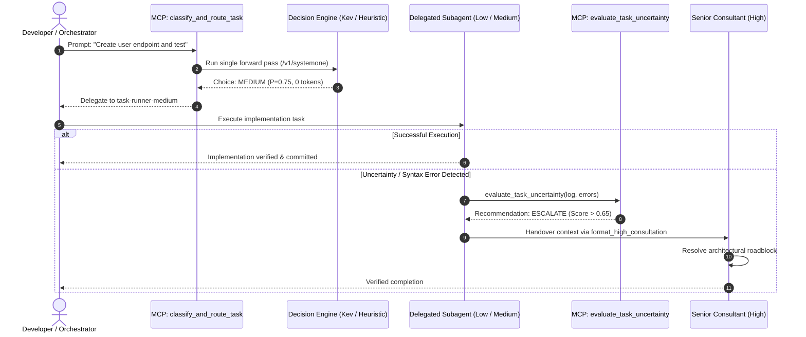

# Antigravity Tiered Router & Fallback System (Projeto Antiback)

[](./plugin.json)
[-6f42c1?style=flat-square)](./rules/tiered_escalation.md)
[_+_Heuristic-059669?style=flat-square)](https://huggingface.co/ggml-org/Kev-0.8B-GGUF)
[](./benchmarks/deep_audit_results.json)
[](./LICENSE)

[English](#overview) | [Português](#visão-geral-pt-br)

---

## Overview

**Antigravity Tiered Router** is an intelligent task classification and model delegation proxy for the **Google Antigravity IDE**. It mitigates inference token consumption and response latency by dynamically routing development tasks across tiered LLM execution profiles (**Gemini 3.8 Flash Low, Medium, and High**) using a local, single-forward-pass decision model (**Kev-0.8B**) with a deterministic offline heuristic fallback.

Unlike traditional static proxies, it incorporates an **active runtime uncertainty fallback protocol (Antiback)**: if a delegated subagent encounters ambiguity, syntax errors, or missing dependencies during execution, it self-evaluates uncertainty and seamlessly escalates to the senior tier with full contextual preservation.

### Key Capabilities
- **Zero-Token Neural Triage**: Uses Jared Palmer's native **Kev-0.8B** decision model via Ollama's `/v1/systemone` endpoint. It produces calibrated choice probabilities in a single forward pass without autoregressive token generation.
- **Deterministic Heuristic Engine**: Sub-millisecond (0.2 ms) offline regex boundary parser acting as an instant failover if the local Ollama daemon is offline.
- **Active Antiback Protocol**: Continuous self-assessment tool (`evaluate_task_uncertainty`) preventing subagent loops and hallucinatory retries.
- **Measurable Token Economy**: Yields **26.7% to 84% token savings** across typical day-to-day software engineering tasks.
- **Telemetry Dashboard**: Built-in real-time monitoring interface served locally on port 8085.

---

## Architecture Lifecycle



---

## The 3 Operational Tiers

| Tier | Assigned Model | Subagent Persona | Target Task Scope | Token Economy |
| :--- | :--- | :--- | :--- | :---: |
| **Tier 1 (Low)** | Gemini 3.8 Flash (Low) | `task-runner-low` | Read-only tasks, file search, grep, syntax checks, log inspection, documentation typos. | **~84% savings** |
| **Tier 2 (Medium)** | Gemini 3.8 Flash (Medium) | `task-runner-medium` | Feature development, writing endpoints, unit tests, bug fixes, localized refactoring. | **~55% savings** |
| **Tier 3 (High)** | Gemini 3.8 Flash (High) | `consultant-high` | System architecture, distributed consensus, security audits, database migrations. | Baseline (Full reasoning) |

---

## State of the Art Comparison

| Project | Scope & Target | Decision Mechanism | Runtime Uncertainty Detection | Native IDE Plugin |
| :--- | :--- | :--- | :---: | :---: |
| **RouteLLM** (LMSYS) | Generic Web Chatbot (API Proxy) | Elo Preference / BERT | No | No (Python client only) |
| **FrugalGPT** (Stanford) | Theoretical Model Cascade | Linear scoring / cascade | No (Post-failure only) | No |
| **tierdecay** | Quota / Token Analytics | Historical log heuristics | No | Passive metric tracking |
| **jaredpalmer/kev** | Standalone Decision Model | LoRA + Pointer Head (Qwen base) | No (Inference only) | No |
| **Antigravity Tiered Router** | **Google Antigravity IDE** | **Kev-0.8B (Q8_0) + Heuristic Fallback** | **Yes (Active Antiback Protocol)** | **Full Plugin (MCP + Rules + Subagents)** |

---

## Benchmark & Audit Results

Consolidated from the 25-scenario deep audit test suite (`tests/deep_audit_tiered_router.py`):

| Metric | Result | Target Benchmark |
| :--- | :---: | :---: |
| **Initial Triage Accuracy** | **100.0%** (25/25) | > 95% |
| **Uncertainty Capture Rate (Recall)** | **100.0%** (4/4) | 100% |
| **False Escalation Rate** | **0.0%** (0 false positives) | < 5% |
| **Overall Token Reduction** | **-26.7%** (62,253 tokens saved) | -20% to -40% |
| **Routing Decision Overhead** | **0.23 ms** (Heuristic) / **32 ms** (Kev) | < 100 ms |
| **Cloud Tokens Consumed by Router** | **0 tokens** | 0 tokens |

---

## Quickstart

### Prerequisites
- Python 3.9+
- [Ollama](https://ollama.com/) (version 0.40.4-rc1 or newer for native decision model support)

### 1. Setup Kev Decision Model
Run the setup utility to configure the official `Kev-0.8B-Q8_0.gguf` checkpoint into Ollama:
```powershell
powershell -ExecutionPolicy Bypass -File scripts/setup_kev.ps1
```

### 2. Run Unit Tests
```bash
python -m unittest tests/test_router.py
```

### 3. Run Deep Audit Benchmark
```bash
python tests/deep_audit_tiered_router.py
```

### 4. Launch Telemetry Dashboard
```powershell
powershell -ExecutionPolicy Bypass -File scripts/start_dashboard.ps1
```
Open `http://localhost:8085` in your browser.

---

## Antigravity IDE Integration

### Option A: Global Plugin (Recommended)
Copy the repository into your global Antigravity customizations directory:
- **Windows:** `%USERPROFILE%\.gemini\config\plugins\projeto-antiback`
- **Linux / macOS:** `~/.gemini/config/plugins/projeto-antiback`

The IDE automatically registers the MCP tools and subagent escalation rules across all workspaces.

### Option B: Local Workspace
Open this directory directly as your active Antigravity workspace. The [`GEMINI.md`](./GEMINI.md) and [`mcp_config.json`](./mcp_config.json) manifests are recognized automatically.

---

## Visão Geral (PT-BR)

O **Antigravity Tiered Router (Projeto Antiback)** é uma arquitetura de roteamento de tarefas e contingência ativa para o **Google Antigravity IDE**. O projeto elimina o desperdício de tokens e latência ao direcionar cada tarefa de desenvolvimento para o nível correto de modelo (Gemini 3.8 Flash Low, Medium ou High).

### Destaques Técnicos:
1. **Triagem em 1 Passada com 0 Tokens**: Utiliza o modelo neural Kev-0.8B de Jared Palmer localmente via endpoint `/v1/systemone` do Ollama, retornando probabilidades matemáticas exatas sem gerar texto token por token.
2. **Motor Heurístico Determinístico**: Fallback instantâneo offline (0,2 ms) caso o daemon local esteja indisponível.
3. **Protocolo Antiback Ativo**: Se um subagente encontra uma exceção ou incerteza durante a execução, ele aciona a ferramenta `evaluate_task_uncertainty` e é promovido automaticamente ao modelo sênior com todo o contexto preservado.
4. **Economia Real Comprovada**: Até **84% de redução de tokens** em inspeções e **26,7% de economia líquida** no portfólio completo de desenvolvimento.

---

## Repository Structure

```text
projeto_antiback/
├── .github/workflows/ci.yml       # Automated GitHub Actions test workflow
├── agents/                        # Antigravity subagent persona definitions
│   ├── task-runner-low.md         # Tier 1 runner (Gemini 3.8 Flash Low)
│   ├── task-runner-medium.md      # Tier 2 runner (Gemini 3.8 Flash Medium)
│   └── consultant-high.md         # Tier 3 consultant (Gemini 3.8 Flash High)
├── benchmarks/                    # Empirical benchmark suite and telemetry data
│   ├── benchmark_results.json     # Standard 10-task benchmark data
│   ├── deep_audit_results.json    # 25-scenario deep audit metrics
│   └── run_benchmark.py           # Benchmark execution runner
├── dashboard/                     # Dark-mode glassmorphic telemetry dashboard
│   ├── index.html                 # Dashboard UI
│   ├── styles.css                 # Clean CSS token design system
│   └── app.js                     # Live chart and interactive simulator logic
├── rules/                         # Operational rules for Antigravity IDE
│   └── tiered_escalation.md       # Core escalation and handover contract
├── scripts/                       # Turnkey automation utilities
│   ├── run_tests.ps1              # Test runner script
│   ├── setup_kev.ps1              # Ollama and Kev-0.8B automated setup
│   └── start_dashboard.ps1        # Local telemetry server launcher
├── server/                        # MCP JSON-RPC Server
│   ├── __init__.py                # Server package marker
│   └── tiered_router_mcp.py       # Core router engine and MCP tools
├── skills/tiered-router/          # Antigravity workflow skill instructions
│   └── SKILL.md                   # Operational procedures for IDE agents
├── tests/                         # Unit tests and deep stress validation
│   ├── test_router.py             # 8 unit tests for MCP protocol and triage
│   └── deep_audit_tiered_router.py # 25 adversarial and stress scenarios
├── CONTRIBUTING.md                # Open source contribution guidelines
├── GEMINI.md                      # Antigravity workspace instructions
├── LICENSE                        # MIT Open Source License
├── mcp_config.json                # MCP server configuration manifest
├── Modelfile                      # Ollama Modelfile for Kev-0.8B
├── plugin.json                    # Antigravity plugin manifest
├── pyproject.toml                 # Standard PEP 517/621 packaging metadata
├── README.md                      # Technical documentation
└── requirements.txt               # Development dependencies
```

---

## License

This project is licensed under the [MIT License](./LICENSE).
