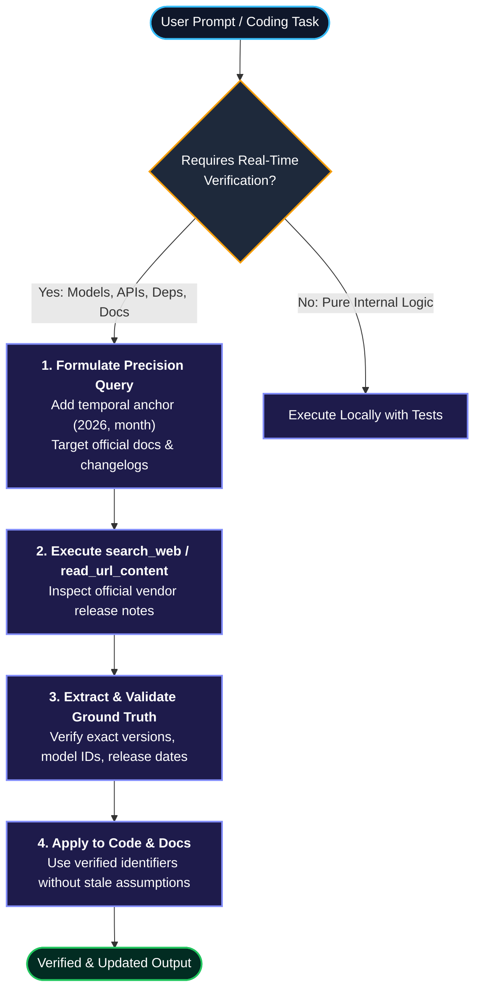

# Real-Time Information Verification & Internet Research Skill

This skill enforces proactive, real-time web verification to guarantee that all architectural decisions, model designations, package dependencies, documentation, and code implementations reflect the absolute latest state of the art.

---

## 1. Core Operating Principles

1. **Zero-Assumption Stance**:
   - Never assume pre-trained knowledge regarding model releases, package versions, deprecation status, or recent API designs is up to date.
   - Models evolve continuously (e.g., transition from Claude 3 Opus to Claude Opus 5.5 in late 2026, or GPT-6 / Sol updates). Always query the web before asserting model availability or specs.

2. **Temporal Anchoring**:
   - Always anchor search queries to the current temporal context (e.g., include `2026`, `October 2026`, `latest`, `changelog`).
   - Discard or flag any information superseded by newer releases.

3. **Authoritative Grounding**:
   - Prioritize primary documentation, vendor release notes, official engineering blogs, and GitHub release tags over secondary summaries or speculative commentary.

---

## 2. When to Trigger Real-Time Research

Activate this verification workflow automatically when:
- **Model Triads & AI Ecosystems**: Any task mentioning LLMs, decision engines, reasoning tiers, API endpoints, context windows, or model names (Anthropic Claude, Google Gemini, OpenAI GPT, DeepSeek, Ollama/Qwen, etc.).
- **Software Dependencies**: Adding or updating packages in `package.json`, `requirements.txt`, `pyproject.toml`, `Cargo.toml`, or `go.mod`.
- **API Methods & Breaking Changes**: Using framework features or libraries where signatures may have evolved (e.g., Next.js, LangChain, MCP protocol specs, Pydantic, FastMCP).
- **Documentation Audits**: Reviewing or writing `README.md`, developer guides, or architecture docs with vendor tables.
- **Explicit Temporal Prompts**: Queries including words like *"recente"*, *"atual"*, *"hoje"*, *"latest"*, *"outubro 2026"*, or *"pesquise"*.

---

## 3. Systematic Verification Procedure

### Step 1: Formulate Precision Search Queries
Construct queries that filter out stale SEO content and target primary sources:
- **Model releases**: `"Anthropic" "Claude Opus 5.5" release 2026` or `"Gemini 4 Argon" specs Google 2026`
- **Library versions**: `pydantic latest version changelog 2026` or `site:github.com/astral-sh/uv releases`
- **Official domains**: Use `site:anthropic.com`, `site:openai.com`, `site:blog.google`, or official docs.

### Step 2: Retrieve & Inspect
- Use `search_web` to retrieve high-confidence summaries and URLs.
- If deep API signatures or raw code examples are required, use `read_url_content` on the official documentation page.

### Step 3: Cross-Check Against Codebase
- Cross-reference retrieved versions and parameters against existing project manifests (`requirements.txt`, `README.md`, `agents/*.md`, `server/*.py`).
- Replace deprecated nomenclature with the exact strings extracted from official sources.

### Step 4: Deliver with Verified Accuracy
- Cite verified model names, version numbers, or documentation links directly in the response or commit message.
- If an entity or library has breaking changes, explicitly highlight migration notes to the user.

---

## 4. Quick Checklist Before Delivering Answers or Code

- [ ] Are all mentioned AI model IDs active and verified for the current date (e.g., late 2026)?
- [ ] Were package versions or dependencies verified against their current registry (PyPI, npm, GitHub)?
- [ ] Are deprecated methods or parameters purged from proposed code snippets?
- [ ] Does the technical documentation or README avoid outdated legacy examples?
